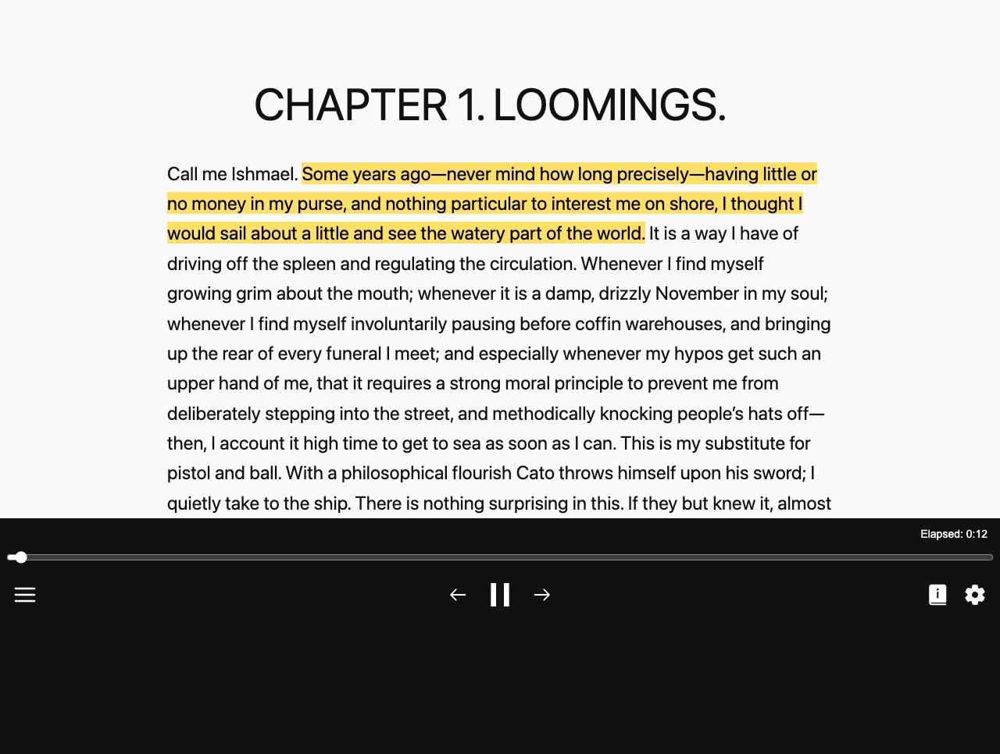

# accessible-books-in-browsers

[GitHub project page](https://github.com/daisy/accessible-books-in-browsers)

This project converts EPUBs into web books you can read in any browser. Media Overlays playback
with synchronized text highlight is preserved. The result is a folder of HTML files you can put on
any website. It works without JavaScript too, just with fewer features.

- [Demos](#demos)
- [Browser converter](converter/) (beta). Convert a book right in your browser, on a computer. There's nothing to install.
- [Documentation](docs/) for developers, about how the converter and the reader work.

## Features

[](https://daisy.github.io/accessible-books-in-browsers/)

The [feature tour](https://daisy.github.io/accessible-books-in-browsers/) shows each one in a few seconds.

### Reading

- Narration plays with the current phrase highlighted. It keeps going from page to page, even with
  the screen locked, and works with the lock screen and media keys.
- A timeline for the whole book, with time left in the chapter and the book, and playback speed.
- Caption mode shows just the phrase being read, large, on its own.
- The book's table of contents, with Find a section and Show levels to narrow it.
- Go to a print page, previous and next page, and previous and next phrase.
- Search, in any language.
- Where am I? tells you what you're in (a footnote, say, or a table in a sidebar) and which heading
  it's under.
- Books reopen where you left off. The address always points to where you are, so bookmarks and
  shared links come back to the same place.
- Follow a note and come back to exactly where you were. Narration reads the note and comes back too.
- Leave a table, list, figure, equation, sidebar or note with one key, or skip page numbers, notes
  or sidebars entirely.
- Vertical writing and right-to-left books keep their direction.
- Save a book for offline reading, narration included. This needs HTTPS (or localhost), and the
  browser has to allow site storage. Safari may delete a saved book if you use Safari for seven
  days without visiting the book's site. A site added to the Home Screen counts its own days of
  use instead.
- About shows the book's metadata, your progress, and the publisher's accessibility information.

### Settings

- Colors, highlight, font, text size, spacing and line length. Or turn on As published to see the
  publisher's own design, chosen per book.
- Keyboard shortcuts for everything, and you can change them.
- Structure sounds (off by default) play tones at headings, notes, lists and tables.
- Settings apply to every book on the same website. You can export and import them.

### Accessibility

- Built and tested against WCAG 2.2 AA. Every demo page is checked with axe, except the math
  book, which is spot-checked because it's so large. The keyboard shortcuts avoid screen reader
  commands.
- Without JavaScript, every page still has plain links to Contents, About, Previous and Next, and
  the browser's own audio player.

### Experimental

AI assistants in the browser can move through the book, control narration and settings, and search
and read it. This uses WebMCP, which only works in Chrome and Edge for now.

## Demos

All of these were made with the [converter](convert/). For who owns each book and how it's licensed, see [About the demos](demos/README.md).

| Book | Demo | HTML fileset | Original EPUB | Notes |
|---|---|---|---|---|
| **Action for Heroes** | [demo](https://daisy.github.io/accessible-books-in-browsers/demos/action-for-heroes) | [HTML fileset](https://github.com/daisy/accessible-books-in-browsers/tree/main/demos/action-for-heroes) | [original EPUB](https://github.com/daisy/accessible-books-in-browsers/tree/main/source-epubs/action-for-heroes) | — |
| **Moby Dick** | [demo](https://daisy.github.io/accessible-books-in-browsers/demos/moby-dick) | [HTML fileset](https://github.com/daisy/accessible-books-in-browsers/tree/main/demos/moby-dick) | [original EPUB](https://github.com/daisy/accessible-books-in-browsers/tree/main/source-epubs/moby-dick) | — |
| **Amar Bangla Boi, Class 5** (আমার বাংলা বই পঞ্চম শ্রেণি) | [demo](https://daisy.github.io/accessible-books-in-browsers/demos/AmarBanglaEPUB) | [HTML fileset](https://github.com/daisy/accessible-books-in-browsers/tree/main/demos/AmarBanglaEPUB) | [original EPUB](https://github.com/daisy/accessible-books-in-browsers/tree/main/source-epubs/AmarBanglaEPUB) | — |
| **Bangladesh o Bishwoporichoy, Class 4** (বাংলাদেশ ও বিশ্ব পরিচয় চতুর্থ শ্রেণি) | [demo](https://daisy.github.io/accessible-books-in-browsers/demos/BangladeshBishwoporichoyEPUB) | [HTML fileset](https://github.com/daisy/accessible-books-in-browsers/tree/main/demos/BangladeshBishwoporichoyEPUB) | [original EPUB](https://github.com/daisy/accessible-books-in-browsers/tree/main/source-epubs/BangladeshBishwoporichoyEPUB) | — |
| **English for Today, Classes 9–10** | [demo](https://daisy.github.io/accessible-books-in-browsers/demos/EnglishForTodayEPUB) | [HTML fileset](https://github.com/daisy/accessible-books-in-browsers/tree/main/demos/EnglishForTodayEPUB) | [original EPUB](https://github.com/daisy/accessible-books-in-browsers/tree/main/source-epubs/EnglishForTodayEPUB) | — |
| **Current Situation of SRHR of Persons with Disabilities in Bangladesh in the Context of SDGs and UNCRPD** | [demo](https://daisy.github.io/accessible-books-in-browsers/demos/CurrentSituationEPUB) | [HTML fileset](https://github.com/daisy/accessible-books-in-browsers/tree/main/demos/CurrentSituationEPUB) | [original EPUB](https://github.com/daisy/accessible-books-in-browsers/tree/main/source-epubs/CurrentSituationEPUB) | — |
| **Kusamakura** (草枕), Natsume Sōseki | [demo](https://daisy.github.io/accessible-books-in-browsers/demos/kusamakura) | [HTML fileset](https://github.com/daisy/accessible-books-in-browsers/tree/main/demos/kusamakura) | [original EPUB](https://github.com/daisy/accessible-books-in-browsers/tree/main/source-epubs/kusamakura) | Japanese in vertical writing, with ruby and narration for chapters 1 and 2. |
| **Mathematical Optimization for Machine Learning**, De Gruyter | [demo](https://daisy.github.io/accessible-books-in-browsers/demos/math-optimization-ml) | [HTML fileset](https://github.com/daisy/accessible-books-in-browsers/tree/main/demos/math-optimization-ml) | [original EPUB](https://github.com/daisy/accessible-books-in-browsers/tree/main/source-epubs/math-optimization-ml) | A math textbook with MathML. Good for trying out copying equations, and for long pages. |
| **The Real Mother Goose** | [demo](https://daisy.github.io/accessible-books-in-browsers/demos/real-mother-goose) | [HTML fileset](https://github.com/daisy/accessible-books-in-browsers/tree/main/demos/real-mother-goose) | [original EPUB](https://github.com/daisy/accessible-books-in-browsers/tree/main/source-epubs/real-mother-goose) | — |
| **Valentin Haüy – the Father of the Education for the Blind**, Beatrice Christensen Sköld | [demo](https://daisy.github.io/accessible-books-in-browsers/demos/valentin-hauy) | [HTML fileset](https://github.com/daisy/accessible-books-in-browsers/tree/main/demos/valentin-hauy) | [original EPUB](https://github.com/daisy/accessible-books-in-browsers/tree/main/source-epubs/valentin-hauy) | A short history book, narrated in full, with the print edition's page numbers. |
| **Notes Test Book** | [demo](https://daisy.github.io/accessible-books-in-browsers/demos/notes-test) | [HTML fileset](https://github.com/daisy/accessible-books-in-browsers/tree/main/demos/notes-test) | [original EPUB](https://github.com/daisy/accessible-books-in-browsers/tree/main/source-epubs/notes-test) | A short test book for notes, with footnotes on the same page and endnotes in a separate file. The narration is synthetic (macOS `say`). |

## Keyboard shortcuts

| Shortcut | Where it works | What it does |
|---|---|---|
| `Escape` | While narration is positioned in an escapable structure | Leave the current structure, or return from a note visit to the text. At a page boundary, continue onto the next page; at the end of the book, stop. While a message from another shortcut is showing, the first `Escape` dismisses the message |
| `[` | Anywhere outside a text field or open popover | Previous phrase, continuing onto the previous page from the first phrase of a page |
| `]` | Anywhere outside a text field or open popover | Next phrase, continuing onto the next page from the last phrase of a page |
| `\` | Anywhere outside a text field or open popover | Play / pause |
| `Alt`+`Shift`+`P` | Anywhere outside a text field or open popover | Go to narration position: moves focus, and a screen reader, to the phrase narration is on, e.g. to read on from there after pausing |
| `Alt`+`Shift`+`R` | Anywhere outside a text field or open popover | Play from here: starts narration at the phrase that has focus (a screen reader's cursor brings focus with it) or at selected text |
| `Alt`+`Shift`+`L` | Anywhere outside a text field or open popover | Show and announce the listening time left in the current chapter and book |
| `Alt`+`Shift`+`Q` | Anywhere outside a text field or open popover | Show and announce the current print page |
| `Alt`+`Shift`+`E` | While narration is on a phrase containing a note reference | Go to the note in this phrase, or open its list of notes |
| `Alt`+`Shift`+`Backspace` (`Option`+`Shift`+`Delete` on a Mac) | After following **Go to note** | Back to text at the exact reference and narration position |
| `Shift`+`[` / `Shift`+`]` | Anywhere outside a text field or open popover | Previous / next page |
| `Shift`+`\` | Anywhere outside a text field or open popover | Caption mode on or off |
| `Alt`+`Shift`+`C` | Anywhere outside a text field or open popover | Open the table of contents |
| `Alt`+`Shift`+`F` | Anywhere outside a text field or open popover; in the open table of contents | Open search. In the table of contents, go to Find a section |
| `Alt`+`Shift`+`V` | In the open table of contents | Go to Show levels, where the arrow keys choose how many levels of sections show |
| `Alt`+`Shift`+`G` | Anywhere outside a text field or open popover | Open Go to page |
| `Alt`+`Shift`+`S` | Anywhere outside a text field or open popover | Open Settings |
| `Alt`+`Shift`+`O` | Anywhere outside a text field or open popover | Open About this publication |
| `Alt`+`Shift`+`,` / `Alt`+`Shift`+`.` | Anywhere outside a text field or open popover | Narration slower / faster |
| `Alt`+`Shift`+`-` / `Alt`+`Shift`+`=` | Anywhere outside a text field or open popover | Smaller / larger text |
| `↑` `↓` `←` `→` | Anywhere outside a form control or open popover, only while Caption mode is on | Same as `[` / `]` (on a page without narration, steps through its text) |
| Unassigned (choose a key in Settings) | Anywhere outside a text field; in an open panel too, if the key has `Alt`, `Ctrl` or `Cmd` | Where am I? Announce the structure and heading at the reading position, or the panel and item that has focus |
| Unassigned (choose a key in Settings) | Selection, focus or narrated phrase | Copy equation |
| Unassigned (choose a key in Settings) | Selected text or focused code block | Copy selection / Copy code |

On a Mac, `Alt` is `Option`. You can change any shortcut in Settings, under Change keyboard
shortcuts. The editor's Find a shortcut narrows the list by name or key (for example "contents"
or "alt shift c"), and the editor warns you about keys a screen reader uses. `[`, `]` and `\` work by
physical key, so they work on any keyboard layout. The Keyboard shortcuts setting turns them all
off (WCAG 2.1.4).

## Converting a book

You can use the [browser converter](converter/) or the command line. For the command line, in
`convert/`:

```sh
npm install
npm run build
npm run convert -- <input> <output> template [options]
```

`<input>` is an EPUB file or folder, `<output>` is where the book goes, and `template` is the
reader (`convert/template`). The converter expects a valid EPUB but doesn't check, so run EPUBCheck
on yours first. Keep your EPUBs too. When the book format changes, you'll need to convert them again.

| Option | What it does |
|---|---|
| `--no-publisher-styles` | Leave out the publisher's stylesheets, and with them the As published choice. |
| `--no-heading-titles` | Keep the EPUB's page titles. Normally, if every page's title is just the book title, each page gets its first heading as its title instead. |
| `--no-split-chapters` | Keep each content document as one page. Normally, a content document is split into a page per chapter wherever the table of contents points inside it. |
| `--language <tag>` | Use this BCP 47 language instead of the one in the EPUB. It's used for the pages, search and the accessibility information. |
| `--identifier <id>` | Save reading positions under this book ID instead of the EPUB's identifier. |
| `--include-non-linear` | Include spine items marked `linear="no"` in the reading order. |
| `--check` | Also run [Ace](https://daisy.github.io/ace/) on the EPUB and axe on the result, if they're installed. If a check can't run, the report says why. It never stops the conversion. |
| `--audio-cache [dir]` | For development. Reuse each page's narration from an earlier conversion if its clips haven't changed. It's kept in `dir`, or the system's temp folder. This saves most of a conversion's time. |
| `--no-small-audio` | Keep the narration's original encoding (channels, sample rate and bitrate). Normally narration is made small, as mono 24 kHz MP3 at 32 kb/s, which is good for speech, offline reading and slow or expensive connections. |
| `--no-audio-cleanup` | Leave the narration as recorded. Normally the converter adds 5 ms fades at joins, removes rumble below 90 Hz, softens "p" and "b" pops, raises any page quieter than -18 LUFS to that level (louder narration keeps its level), and limits peaks to -1.5 dB. |
| `--audio-enhance <list>` | Which extra narration filters to use, comma-separated. Choose from `warm-eq`, `compression`, `noise`, `deess` and `declick`, or `none`. All five are on by default. They were picked by listening to the demos, and they can change the sound a lot, so listen before using them on a different kind of recording. |
| `--no-remote-ui` | Always use the reader that comes with the book. Normally a book gets reader updates from the v0 update channel, and falls back to its own copy if it can't reach it. See [how it works](convert/REMOTE_UI.md). |
| `--ui-base-url <url>` | Get reader updates from a different channel. |

Each conversion writes a report, `conversion-report.md`. It lists the
options used, what the converter changed, and anything you should look at.
[The conversion report](docs/conversion-report.md) explains it.
